# Screenshots

> Part of the [AIFlowBridge documentation](../README.md).

All captures across the released versions, newest first.
v1.4.0 and v1.1.1 are kept for historical reference.

## v2.15.4

| Description                                                      | Screenshot                                                                                                     |
| ---------------------------------------------------------------- | -------------------------------------------------------------------------------------------------------------- |
| Dashboard with every section visible (hero view)                 | 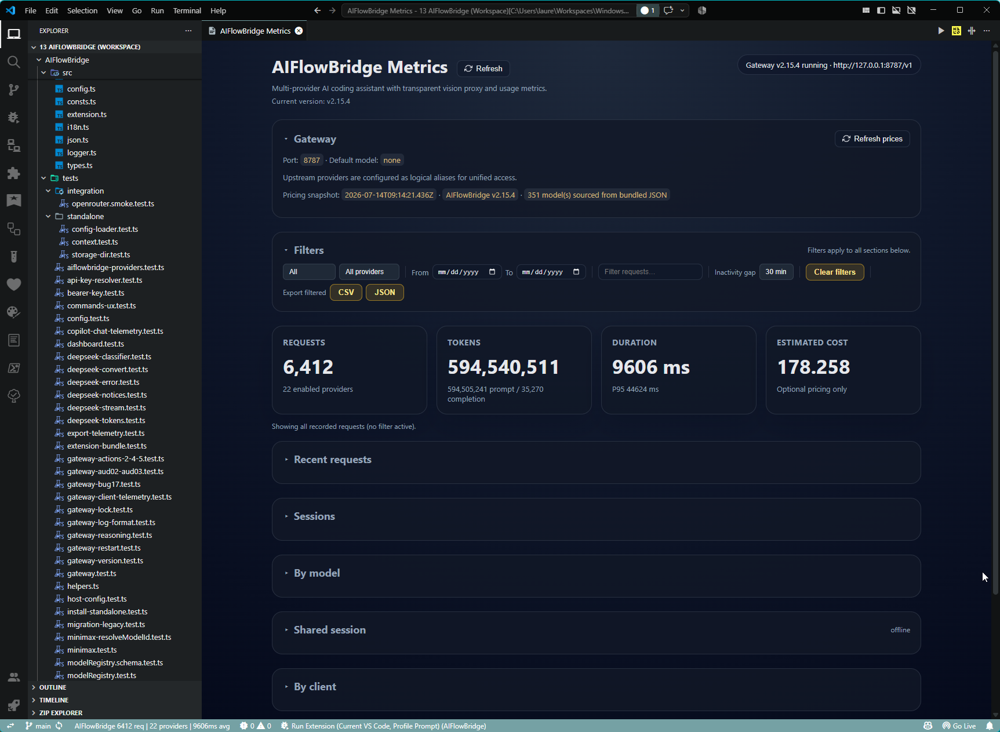                |
| Dashboard after a real prompt (data populated)                   | 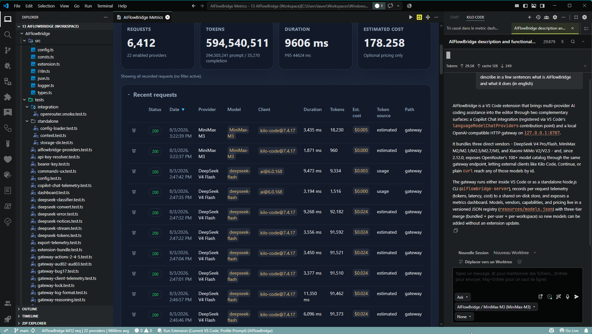            |
| Dashboard with the time preset + provider filter + search active | 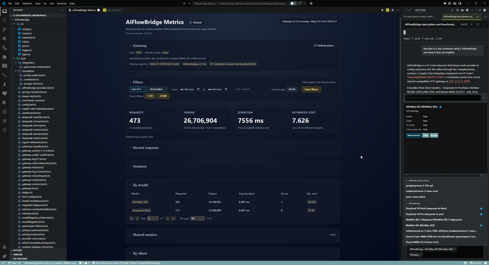              |
| Kilo Code model picker (AIFlowBridge entries)                    |                       |
| Copilot Chat model picker (AIFlowBridge entries)                 |                          |
| Adding the AIFlowBridge provider in Kilo Code                    | 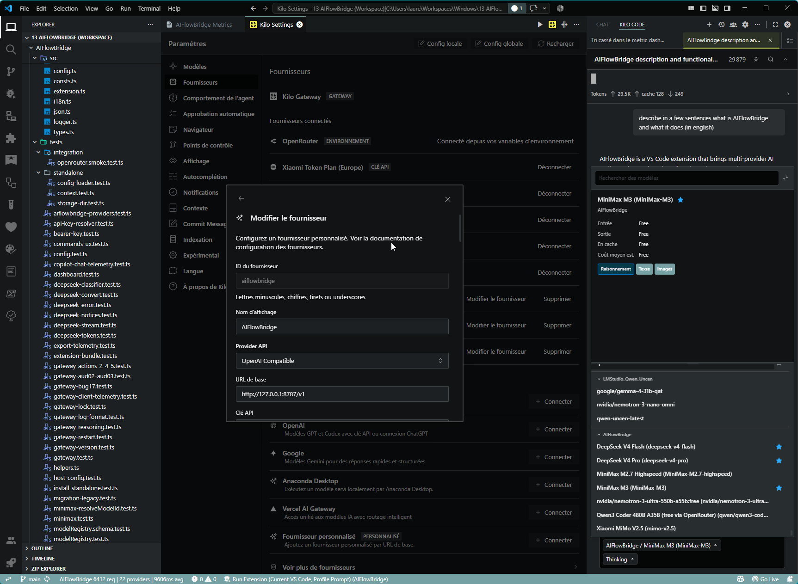 |
| Command Palette showing the AIFlowBridge entries                 | 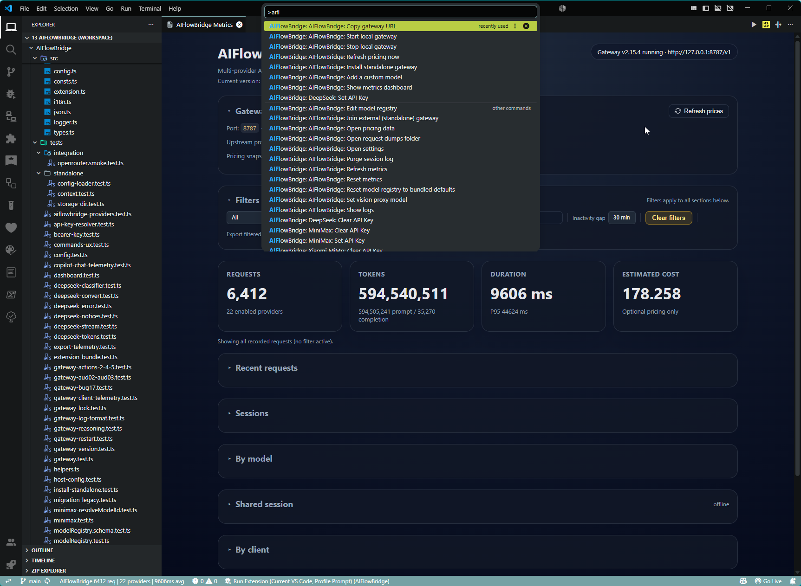                                 |

## v1.4.0

| Description                                                         | Screenshot                                                                   |
| ------------------------------------------------------------------- | ---------------------------------------------------------------------------- |
| API metrics - request list with the time preset and provider filter | 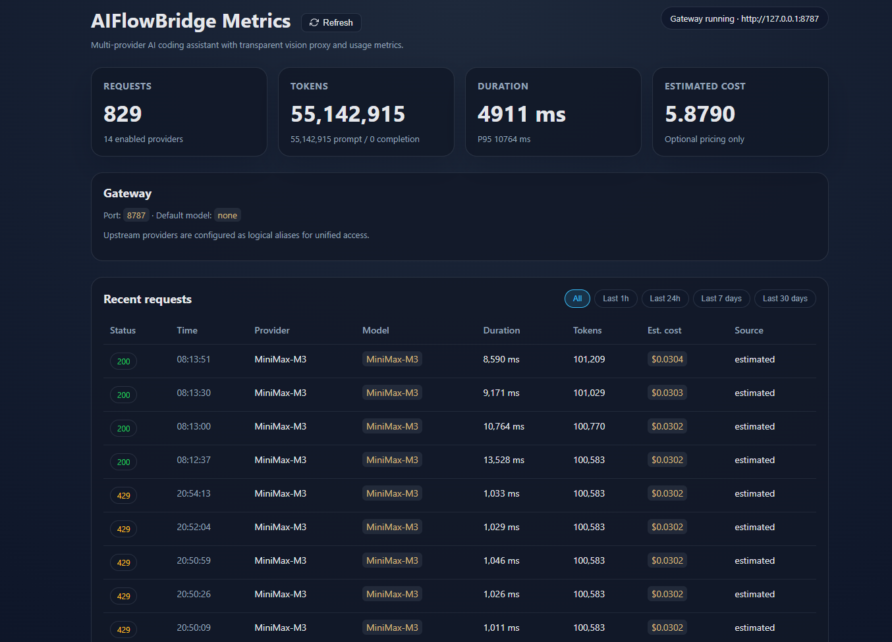 |
| API metrics - per-request details with token counts and latency     | 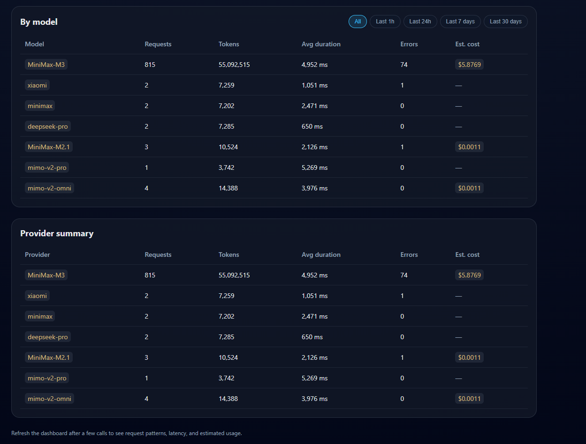 |

## v1.1.1

| Description                                  | Screenshot                                                                                             |
| -------------------------------------------- | ------------------------------------------------------------------------------------------------------ |
| Dashboard after a prompt (original capture)  | 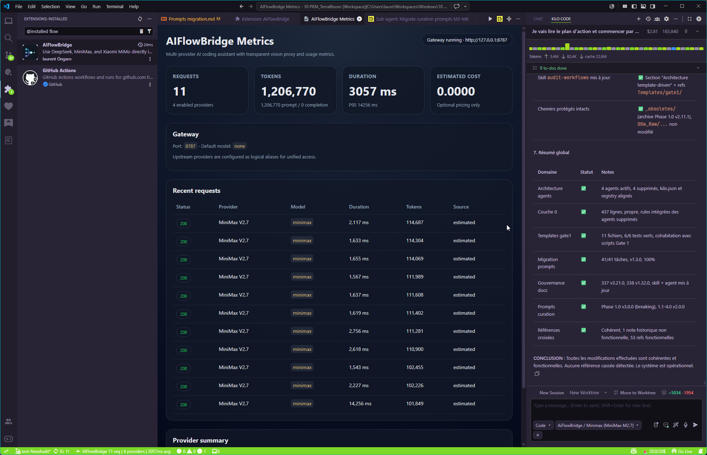 |
| Kilo Code model picker (original capture)    |         |
| Copilot Chat model picker (original capture) |            |
| Vision proxy module for MiniMax in Copilot   | 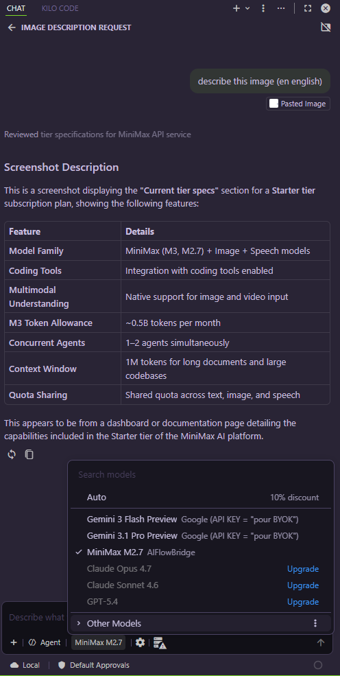     |
| Gateway health endpoint (`GET /health`)      | 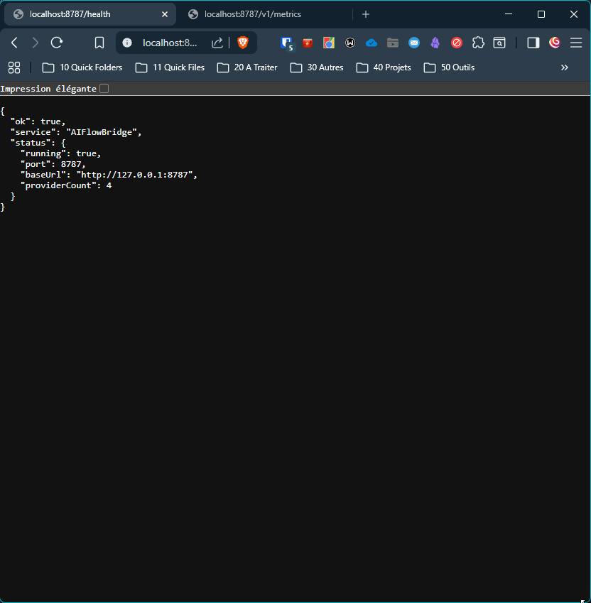                                  |
| API metrics (original capture)               | 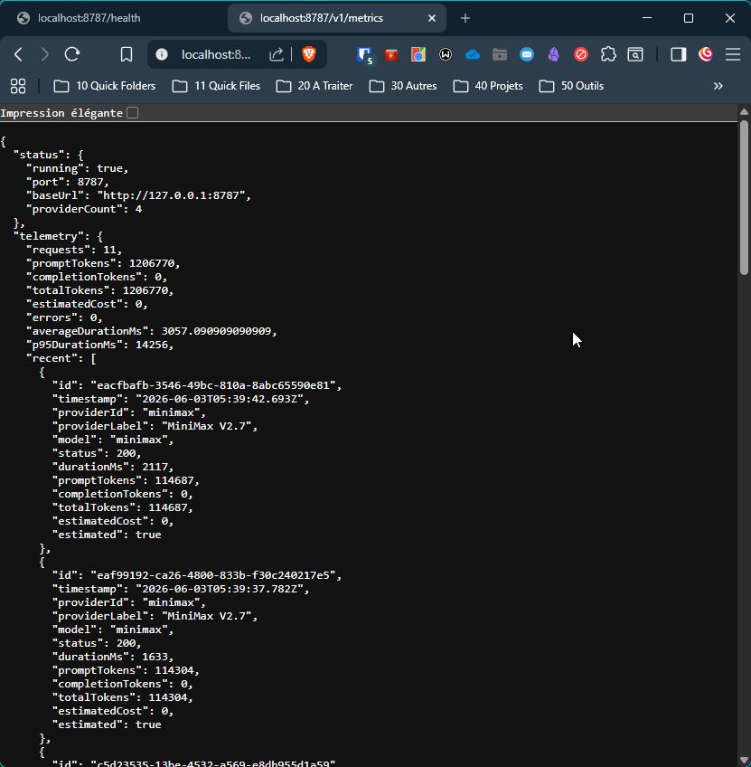                         |
| Output log channel                           | 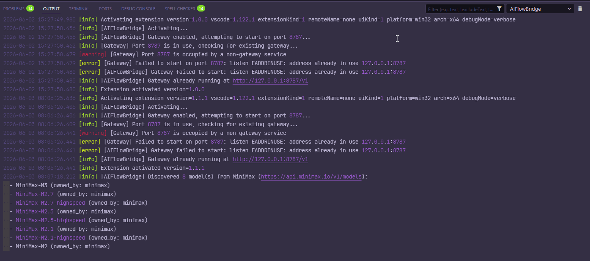                                  |
| Settings page 1                              | 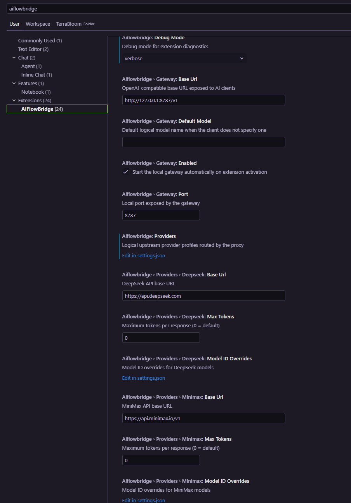                                  |
| Settings page 2                              | 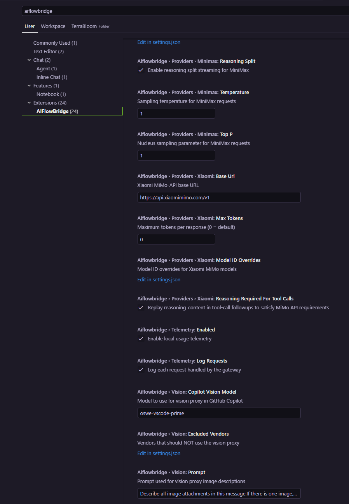                                  |
